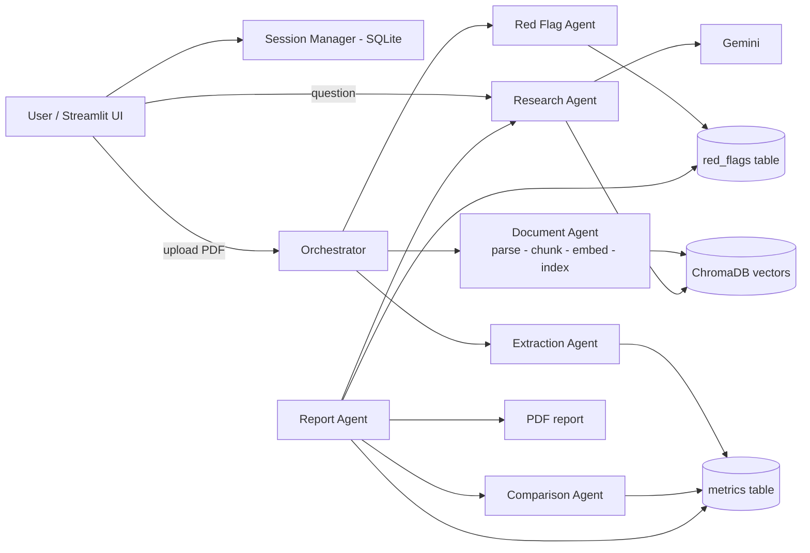

# Architecture — Multi-Agent Financial Research System

## Flow

Pipeline on upload (sequential): Document -> Extraction -> Red Flag. Research, Comparison
and Report agents run on demand.

## Agent responsibilities
| Agent | Input | Output | Milestone |
|---|---|---|---|
| Document | PDF/TXT | page-tagged chunks + embeddings in Chroma | 1 ✔ |
| Extraction | indexed chunks | `metrics` rows (name, value, unit, period, page, quote) | 2 ✔ |
| Red Flag | chunks + metrics | `red_flags` rows (category, severity, page, quote) | 2 ✔ |
| Research | question + session docs | step-by-step answer with `[Company, p.N]` citations | 3 ✔ |
| Comparison | metrics of 2+ companies | side-by-side table + peer commentary | 3 ✔ |
| Report | all of the above | PDF: Summary, Key Financials, Red Flags, Comparison, Outlook | 3-4 ✔ |

## Data model (SQLite)
sessions(id, name, created_at) · documents(id, filename, company, file_hash, n_pages,
n_chunks, is_seed, status) · session_documents(session_id, doc_id) · metrics · red_flags ·
chat_messages.
Chroma chunk metadata: doc_id, company, filename, page.

## Grounding rules (shared by all LLM agents)
1. Prompt contains ONLY retrieved chunks; model must answer "not found in documents" otherwise.
2. Every number/claim carries page + short verbatim quote; Extraction output is validated
   by checking the quote exists in the cited chunk.
3. Temperature 0, JSON-schema outputs for Extraction/Red Flag.

## Key design decisions
- Page-aware chunking -> exact page citations.
- SHA-256 dedup -> seed docs are embedded once, shared across sessions.
- Seed docs auto-attach to every session; users can detach them.
